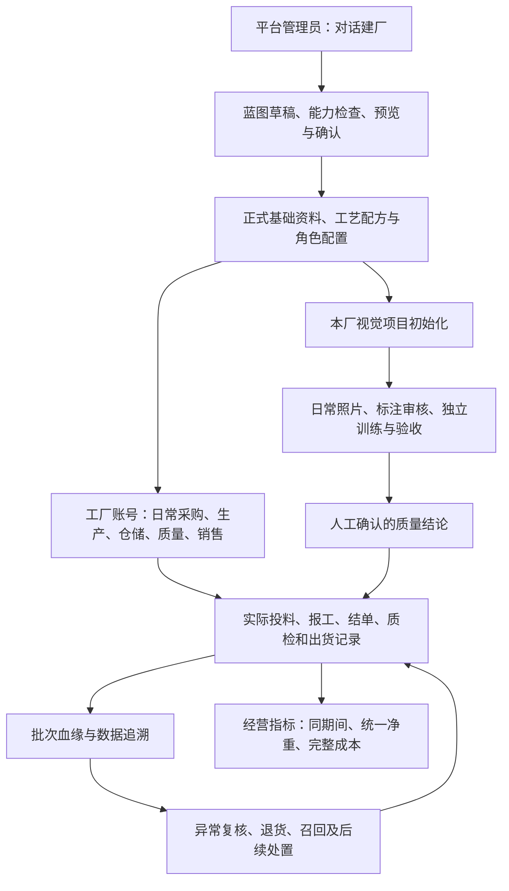

# 平台建厂、工厂日常业务、追溯与经营分析

更新日期：2026-10-19。当前独立分支`codex/factory-generality-units-readiness-20261018`的9项整体本地验收已收口，见[最新能力清单、使用顺序和边界](../acceptance/factory-generality-final-local-20261019.md)。本轮已接通联产追溯，已完成正常迁移启动补验；正式版本切换、四项联产指标、整月退货后利润核对均有本地证据。本文下方2026-10-16差异矩阵属于历史调查，不代表当前待办。

最新主仓只读核对点为`6c4ecfe93ff7751066ea7323e5c6750a7eae11fe`，本分支未向它推送、合并或部署。实现、本地验收、负责人签署和生产发布分别记录。

## 产品结构

系统共用工厂ID、产品/原料/计量与工艺等正式基础资料。平台建厂管理“这家工厂如何运转”的配置；工厂日常模块记录“实际发生了什么”的业务事实；追溯和分析读取这些事实。配置成功不能代替业务数据，更不能当作已经生产、质检或出货。

| 层次 | 操作人员与入口 | 职责及真实连接点 | 使用频率 |
|---|---|---|---|
| 平台建厂 | 平台管理员；`/factory-onboarding` | 对话采集需求、蓝图/草稿检查、预览、确认、支持能力转正；Java `/api/platform/factory-assembly/**`，复用正式资料/配方/工艺服务 | 新厂上线、配置变更 |
| 工厂日常 | 本厂管理者和业务岗位；采购、生产、仓储、质量、销售菜单 | Java `/api/mobile/{factoryId}/**`；写实际业务单据、库存、报工和结单，不绕过现有权限与审批 | 每日 |
| 追溯 | 生产/质量负责人；`/production/traceability?batchNumber=...` | 复用 `TraceabilityServiceImpl`、`LineageGraphAssembler` 以及 `BatchLineageEdge`；从真实来源到出货，缺证据明确展示 | 每批、异常时 |
| 经营指标 | 工厂负责人及已授权财务/生产管理者；`/analytics/indicators` | 复用指标Controller、QueryService、`FactoryActualProductionMetrics` 和既有 Yield/OrderCost 服务；计算记录保存在既有指标版本中 | 每日、每周、每月 |
| 批次事实 | 生产负责人；`/production/batches/{batchId}` | 查看已有投入产出、原料、工时和成本完整性；由追溯中的真实 batchId 跳入。有质量查看权限时可直达该批次既有质检页面；生产清点不代替质检放行 | 指标异常下钻 |
| 视觉训练 | 本厂质量人员；`/quality/vision-training` | 同一SOP和runner；本厂照片/标注/项目/权重/验收隔离。平台可初始化项目，日常持续管理 | 采样、换产、补训练时 |

`PLATFORM_ADMIN` 与 `FACTORY_USER` 是不同身份命名空间。同一数字ID不等于同一角色。平台管理配置与工厂日常使用独立入口，不能将普通工厂人员操作放在平台建厂页中。

## 推荐使用顺序

1. **平台管理员建厂。** 明确工厂类型、生产模式、产品及包装单位、关键工序和岗位。对话结果先成为草稿，逐项预览和检查；只将正式接口支持的内容转正，不静默丢字段。本分支已在共享正式创建服务的同一事务初始化制造新厂的四项实际生产指标；没有业务时显示暂无数据，不复制其他厂历史或阈值。访谈中可用中文名称停用指标，已有停用或删除选择保持。
2. **核对可运营条件。** 核对原料/成品、基本单位及净含量、包装换算、配方与工艺、仓库、质量标准、业务账号与权限；供应商/客户、费率/实际成本等缺项通过既有模块补齐。不能将“平台能建草稿”算成上述内容全部自动启用。
3. **切换工厂账号。** 按岗位进入日常模块；先用一批正常业务验证采购与收料、实际投料、逐道报工、结单/质量清点、入库、订单分配和出货。复用原业务服务，不另建“建厂专属生产系统”。
4. **核对双SKU事实。** 选择至少一个重量单位产品（如kg）和一个计数单位产品（如500克/盒），分别核对真实输入、合格/不良输出、历史净含量与出货。原单位保留，禁止把kg和盒直接相加。
5. **看追溯，再看指标。** 追溯核对供应商、原始收料/调拨来源、加工单位与实际客户出货；经营指标选择相同日期，先看状态和口径，再查该期间完工批次，进入追溯/批次明细核对。完工批次列表只证明完工事实，不代表每批都已满足指标纳入条件。
6. **持续处理异常。** 复用异常复核、退货、召回、报废和财务后续。退款线已完成本地收口，本批不继续扩展财务边界；不能由召回结案推断库存和资金也自动结清。
7. **按需启用本厂视觉训练。** 照片准备→人工标注→审核→确认合格标准→提交现有runner→本厂独立验收→受控启用。六膳门权重只用于其明确登记场景，不作为多工厂通用模型；SOP复用不等于权重泛化。

## 2026-10-16历史差异调查

以下区分“代码存在”“本地链路通过”“主仓已包含”，避免把一个状态当成另一个。比较采用共同祖先 `095ce82d2fc357fa415ea55f8612579cf011bbb1` 的三方差异；某能力只在日常分支新增而主仓缺失，是待集成，不能误说成平台Owner删除。

P13在主仓 `b45399188f` 的机械快照发现，两边相对共同祖先都修改过的 backend/web-admin 代码及测试文件共502个，其中376个最终blob相同，126个有差异。这是带版本的历史对照，不是最新主仓差异计数。前者直接复用；后者包含平台底座继续演进与日常增量，不能把文件差异数说成重复功能数，也不能未经集成测试整批覆盖。P14仅重核正式建厂/apply入口和已有修复，证据见私有 platform-latest.json。

| 能力 | 当前证据 | 是否重复 | 处理方式与优先级 |
|---|---|---|---|
| 平台对话、蓝图、资料/工艺草稿与正式服务 | 主仓与日常分支均继承平台底座；主仓已继续更新生成网关、校验与激活逻辑 | 大量为同一底座；不是两套独立建厂系统 | 平台部分以对应Owner及主仓最新实现为准，复用，不在本分支再造 |
| 采购、部分收货、容差和采购质量退货 | 主仓包含#1002–#1007，累计超退/并发修复已合入；另一Chat仍有ArAp/CI在飞改动 | 与销售退货是不同业务方向，但共用退货服务 | 继续由对应Owner收尾；本分支不重做、不覆盖；未来集成保留AR/AP回归，P0 |
| 客户销售退货、退款撤销、应收及原/红字凭证 | 日常分支P1–P12本地证据；V0044/V0045闭环已验收；未合入主仓 | 与采购应付无同一业务链重复；共享 `ReturnOrderServiceImpl` | 冻结退款线；整合时保留客户/供应商边界与幂等、来源约束，P0 |
| 数据追溯 | 已有图、血缘写入和真实销售出货投影；两种SKU本地实际链通过 | 复用现有读写服务 | 本批补日常指标到批次、追溯到投入产出/成本的入口；修同页切批次及乱序保护，P1 |
| 实际出成率、净重良品率和完整成本 | 日常分支actual-flow-v2已本地验收；四项指标复用Yield/OrderCost，不另建真值库 | 指标引擎已有，不重复开发核算 | 本批接同一期间和多SKU批次事实入口；无样本/缺归集保持不可用，P1 |
| 视觉照片标注与训练SOP | 复用Label QC、VisionLab；日常新增Java工厂/平台代理与Python准备流程尚未带入当前主仓 | 标注工具与训练SOP应复用；平台初始化/日常管理是两种入口 | 记录待集成的接口与工厂隔离验收，P0集成检查；不复制模型或再写标注器 |
| Python分析桥接 | 既有SmartBI客户端复用；日常分支有指标桥接增量，主仓未带入这些同一增量 | 模型服务/客户端已有 | 合并准备清单必须保留固定路径、身份、状态与版本契约；本批不重写Python分析引擎，P0 |
| 新厂自动具备日常指标配置 | 本分支正式create事务自动生成四项定义与既有JPA策略配置；新厂NO_DATA→正常双SKU业务→同日四项AVAILABLE、PG/UI及失败回滚已本地验证；主仓尚未带入 | 复用现有指标引擎，补初始化及中文预览/停用连接 | 已接通；保护既有自定义、停用、删除决定，不复制数值/历史/阈值。后续按主仓集成验收，P1 |
| 同一计划多产出、共用投入的成本与质量分摊 | 当前口径对归属不明返回不可用；现有本地多SKU为各自独立单输出计划 | 尚未证明通用多产出分摊 | 明确业务分摊规则后复用既有分摊能力接线；未验前不猜值，P2 |
| 历史断边、拆并/返工、跨厂血缘 | 有抽象和部分写入路径，历史缺证据不能反推补造 | 不应另建血缘库 | 按来源事实分场景验收；本批不虚构历史，P2 |

## 历史集成边界（当前补验以最新清单为准）

- 建厂逻辑复用最新平台生成/正式化/激活服务；本分支本地体验底座较旧，不能整文件覆盖主仓平台增量。
- 对 `ReturnOrderServiceImpl`、前端路由/菜单、`PythonSmartBIClient` 和 Python main/router做语义合并；采购未提交改动不属于当前冻结快照，不可打包带走。
- 保留 `/api/platform/factory-assembly/.../vision-training` 与 `/api/mobile/{factoryId}/vision-training` 及其Python注册；平台开关关闭时工厂日常入口应继续可用。仅接口存在不等于整链已验收。
- P14已在独立分支完成共享正式“平台创建/预览/确认→新厂账号→双SKU正常业务→追溯→同期间指标”的本地HTTP/PG/UI验收；没有运行联网AI自由生成，也没有合并最新平台生成网关或发布主仓。未来整合后的组合仍需验证，不能把当前分支证据当成未来主仓证据。
- 日常分支与主仓存在旧的同版本不同迁移（包括 `V20261103_63/64`），必须在未来集成前核对已执行历史与Owner后协调；不得覆盖已执行文件或篡改checksum。P14新增操作日志字段扩容是独立窄升级，当前只在隔离库执行，未运行整库Flyway或生产迁移。
- 当前借用的本地库是隔离测试库和已有schema，不能代替空库/已有库Flyway、JPA以及生产验收。

P13历史证据保存在代码外 factory-data-p13；P14的新厂、同期间指标与收尾证据在 `C:/Users/Steve/Documents/cretas-connect-20261015/factory-data-p14/`。本地体验入口为 `http://127.0.0.1:31764/analytics/indicators`，工厂账号 `food_3101_001_admin`，凭据只保存在私有文件。先选同一期间，再从完工批次查看追溯及投入产出；日常使用无需进入平台建厂。业务口径沿用P0档案，退款冻结沿用P12档案；本档不保存密码、原图或模型。
