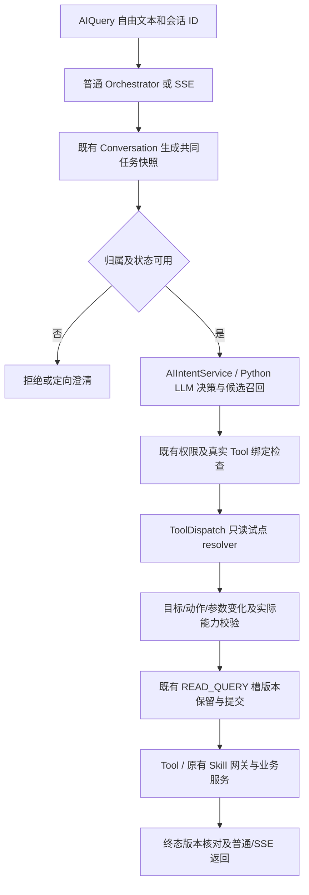

# 语义上下文首切片：实现、真实模型开发验证与发布边界

任务 `SEMANTIC-SALES-20261105`，Owner `01a1a59f-7fcf-76f2-82a2-2cfd0d5fce98`，PR #1476（Draft）。
本记录更新早期 ranking 方案，不将其旧句式策略作为继续实施依据。当前产品源码冻结清单在本机 `C:/Users/Steve/Documents/Cretas意图架构只读审计-20261105/source-freeze-first-slice-final.json`。

## 当前事实与调用链

已复用两份指定只读审计及补充待办；本轮只更新版本、运行配置和任务状态。生产主路径仍保留 Python LLM 决策、本地候选召回/分类、Conversation、resolver、Tool/Skill 和权限规则。精确/短语等历史链不能笼统称为当前唯一主路径。

运行期只读核实：网关 active 为 green/10020；Python matcher 开启，工厂配置空串代表原有全工厂范围。以上是已部署基线，**本 PR 改动尚未部署**。
F006 的 `ORDER_LIST -> order_list`、`MATERIAL_BATCH_QUERY -> material_batch_query` 绑定已证实；`PRODUCT_SALES_RANKING` 生产意图绑定不存在，不能因 Tool 同名存在而算已接线。排行 Tool 实际只按订单金额排序，不支持数量排行。
库存 Tool 现有治理允许来源为 `SKILL_WORKFLOW`；直接 dispatch 的来源为 `AI_INTENT_DISPATCH`，生产形态下会拒绝。本轮保留拒绝，未补录生产配置或弱化治理。订单单状态枚举没有“待发货”；不私自等同为 CONFIRMED/PROCESSING。本次真实模型开发对话明确使用“已确认订单”。

这里的 resolver 并非同一组件：Python matcher 选择意图候选；ToolDispatch 解析只读任务动作和参数变化；原有实体/参数绑定服务落实 ID 与类型；Tool/Skill 执行确定性业务，继续由权限、治理和服务约束。

## 最终改动及准入规则

- 普通和 SSE 复用 `SemanticConversationContextService`，快照来自原 Conversation 服务。状态区分 NEW/PRESENT/EXPIRED/UNKNOWN；读取失败或过期不视为新任务。外部自由文本 `intentCode` 是候选提示，不直接成为执行授权。原有受控 UI/内部动作仍受既有权限检查。
- 新建客户端会话发送 `conversationStart`；已有、未知或他人 session 不会因该标记被重置。服务端派生字段为 `JsonIgnore`，不接受客户端冒充状态、参数来源或版本。
- 提供当前/最近 READ 目标、状态、待填字段和安全参数摘要；仅向外发必要用户历史，不发送助手业务表格和原始实体 ID。对象/页面引用使用受控引用；原始对象仅留本地快照。完整真实结果引用的后续生命周期仍待验证。
- 精确表的 APPROVED 意图标签保留；直达另需 factory/domain/规范化表达/intent 的独立审核路由摘要，以及明确 NEW 且无相关上下文。当前新增的 `registry-route-reviews.json` 为空，因此相关命中只作候选。PRESENT/EXPIRED/UNKNOWN、页面对象或历史上下文不允许按旧精确结果复用参数、结果或授权。
- Java contextual 分支跳过不带上下文的旧缓存/短语提前返回；相关 LLM 不可用时明确失败/澄清，不回退为无上下文确定意图。旧无任务上下文调用兼容保留，不声称全仓所有入口均已统一。
- 只读试点用实际绑定 Tool 的描述/schema 让 LLM 识别 NEW/CONTINUE/CORRECT/SWITCH/CANCEL/CLARIFY/UNSUPPORTED 及参数 delta。保留 NONE/CLARIFY，不将唯一候选伪装成置信度 1。
- 参数顺序：本轮明确修改优先；同目标保留兼容的此前值；换目标清除不兼容条件；模型合并后再补缺省值。既有时间规则、参数 grounding、真实 Tool enum/type/bounds、权限和业务服务做最终校验。数量排行无法通过“理解为销量”后返回金额榜。
- 删除两入口对识别前 `prepare` 句式强制路由的调用；未命中不再清空旧槽、抢先填满默认值。旧方法仅保留兼容/历史测试用途，未新增续句白名单。原数量纠正、写确认、取消机制继续复用。
- READ_QUERY 在同一原记忆槽采用事务内悲观行锁 + 版本 CAS。reserve 保留旧目标直至语义验证成功，终态轮换版本；取消失败回滚、迟到结果不再推进已取消/被替换任务。同目标关联的原 ConversationSession 才被取消，不顺带取消其他草稿。

未引入 IntentHandler、新状态库、新训练或产品多 Agent。

## 验证证据（分层，互不替代）

### 受控服务测试和构建

本机证据目录：`C:/Users/Steve/Documents/Cretas意图架构只读审计-20261105/`。

| 层次 | 当前证据 | 限制 |
|---|---|---|
| Java 目标测试 + package | 14 suites、238 tests、0 failures/errors/skips，`semantic-first-slice-package-3.log`、`first-slice-validation.json` | 不是全仓所有业务测试 |
| 真实 PostgreSQL/JPA | 5 项真实 Spring/Hibernate 事务测试包含在 238 项，覆盖 CAS、跨用户、并发、取消回滚和终态竞争 | CI 未配置隔离 URL 时该类显式 skip；不得算 CI 真实 PG 已跑 |
| Python 相关门禁 | 147 passed，`python-first-slice-gates.log` | 有 1 条现有 warning |
| Web 定向单测 | 2 suites / 8 tests passed，`web-context-tests.log` | 不等于浏览器验收 |
| Web build:check | `web-build-check-2.log` 退出 0，命令级堆 8192MB | 首次默认堆 OOM 记录保留，未改全局配置 |
| 静态 diff / dispatch | diff --check、dispatch 校验通过 | CI 必须另读最终 HEAD |

Java 命令的选择器：`SemanticConversationContextContractTest,SemanticReadTurnResolverContractTest,SalesRankingEntryParityContractTest,SalesRankingSemanticContractTest,ConversationReadVersionContractTest,AIIntentServiceImplPythonIntegrationTest,ProductSalesRankingScopeContractTest,FactoryCatalogToolBehaviorContractTest,FollowUpResolverTest,SlotAnswerRuleTest,SseStreamingServiceFollowUpTest,ToolDispatchServiceLastActionTest,ConversationMemoryOwnershipContractTest,IntentExecutionOrchestratorSuggestedActionSecurityTest`，执行 `mvn -q -Dtest=<selector> package`。PG 指向本任务独有 disposable DB，未改 Repository/Entity/JPQL。

### 真实模型开发回放

直接调用真实 `gpt-6-luna` Decisions；mini 负责请求目的、候选短名单及工具参数变化；Terra 用 Responses API 做教师审阅，教师意见不成为训练真值。模型调用经过统一额度账本，没有更换生产 provider。

`semantic-live-evaluation/entry-probe/attempt6-verified-*` 使用当前真实 Java 普通/SSE 服务类、真实 Python Orchestrator 和生产 Tool 实现；候选目录仅两个已知 READ、权限和业务查询结果受控。不是实际 HTTP controller/浏览器、生产 DB 或全 266 类证明。

| 轮次（普通/SSE 各执行一次） | 模型后最终参数/动作 | 两入口结果 |
|---|---|---|
| 查上月已确认订单 | ORDER_LIST，10月1—31日，CONFIRMED | SUCCESS / SUCCESS |
| 时间改成本月，状态不变 | ORDER_LIST，11月1—30日，CONFIRMED 保留 | SUCCESS / SUCCESS |
| 查今天入库的原料 | MATERIAL_BATCH_QUERY，当日，移除订单状态 | SUCCESS / SUCCESS |
| 不用查了 | CANCEL，READ_QUERY 终态 CLEARED | CANCELLED / CANCELLED |

开发回放 8/8 轮、2/2 对话通过；失败/未知均留在其所属尝试记录中。此前适配器失败（请求 chunked 读取、错误依赖注入、路径参数文件等）完整保留，不当作产品成功，也不悄悄丢弃。**无同题旧源码真实模型数值基线，不能声称量化提升。**

该次 32 次真实模型调用：mini 24 次（input 16,649 / output 605），Luna 8 次（input 5,669 / output 0）。真实服务轮延迟 nearest-rank p50 5.352s，p95 7.711s，样本仅8轮；每轮4次调用。按未缓存标准费率估算 $0.015776，保守缓存写入上界 $0.016627，非账单实扣，也未假定免费抵扣。

此前裸 Luna 公开开发 8 项中冻结期望为7/8；“不用的原料还有多少”没有误取消，但目标/动作未达期望，仍记失败/待审。Terra 复核指出“库存中的不用/闲置”能力含义需先澄清，不改写成绩使其变为通过。
97.11%=773/796 保留为旧离线标签指标；上述结果不能证明真实多轮达到95%，也不能证明线上综合成功率。

预算采用用户新授权累计 $100，上报可用余额 $100.26；历史标准成本基线不二次扣减。截至本报告生成时，新增标准价保守估算约 $0.038668，旧未知请求预留 $0.19863，总上界 $0.237298。实时值以统一 `budget-reconciliation.json` 为准，不是余额 API 或结算账单。

## 飞轮、排除及未完成项

读取现有 F006 只读记录后发现29个 Tool 会话，4组可列候选，但全部独立来源状态 UNKNOWN。摘要只留脱敏/哈希；未把原始业务内容发送教师。它们未经来源、近邻和预期行为预审，**不能充当独立验收 gold 或训练集**。见 `independent-source-audit/independent-source-audit.json`。

| 错误/候选类型 | 本轮处置 |
|---|---|
| 确认的完整独立问句分类错误 | 仅可进入待人工审阅候选；本轮未新增训练真值 |
| 上下文丢失、合并、默认值、版本竞争 | 代码/契约修复，不写为分类器负例 |
| Tool未绑定、来源治理拒绝、能力不支持 | 能力/接线问题，不靠训练掩盖或补录生产配置 |
| 教师赞同、执行成功、用户否定 | 都不自动转为 gold |
| 35/796、已打开集、公开例子及近邻 | 持续排除训练与独立验收；本轮不训练 |

尚未验证/尚未实施：全矩阵精确表启用/绕过收益；真实模型对“待发货”能力澄清；页面/首条结果真实对象ID的两步只读任务；通用多草稿中断/恢复与“继续”歧义；所有写草稿更改后的确认失效组合；真实独立多轮 gold；实际 HTTP/UI；生产治理下库存入口成功。已有通用数量纠正/取消回归保留，但不据此宣称这些新增场景全覆盖。

当前阶段只交付首切片分支候选及其证据。commit、push、最终HEAD CI、合并和部署分开记录于收尾回执。冻结未解除，不 merge、不推 main、不部署、不替换线上模型。
